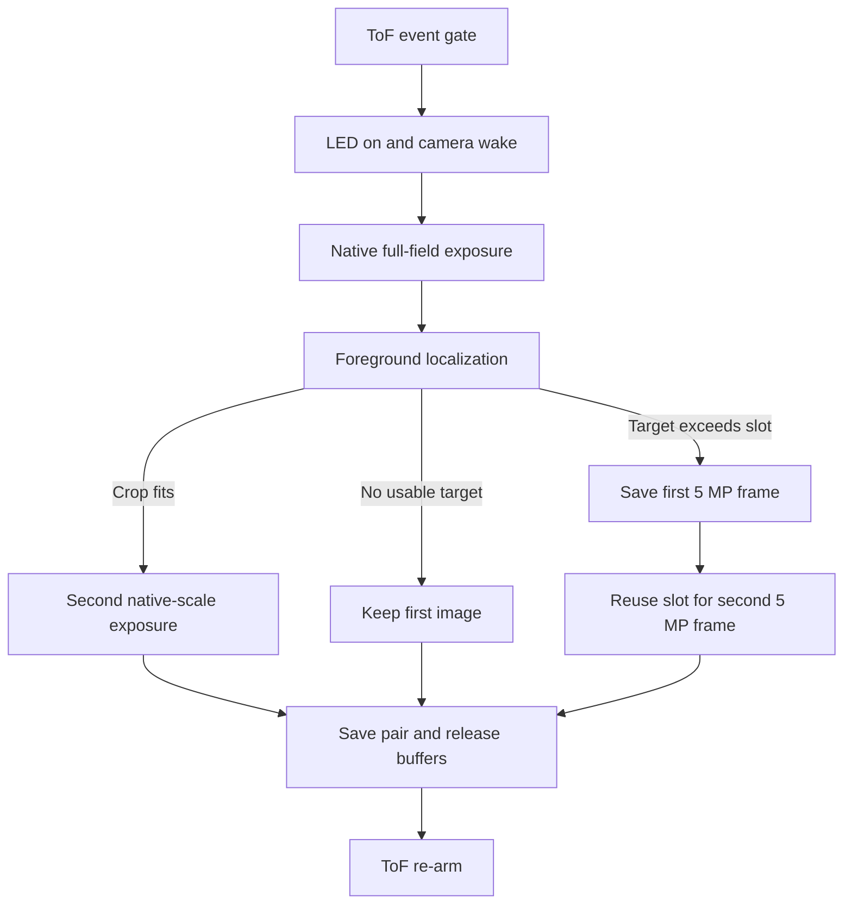

# MASSIF insect imaging system

**Engineering architecture and algorithm reference**  
STM32N6 · VL53L5CX · Sony IMX335 · microSD

This reference describes the ToF-triggered native-color burst in capture mode 4. It distinguishes the working firmware reported from the bench, the configuration patch prepared here, and measurements still needed on the target. Earlier project notes document other capture modes and experimental sensor-windowing paths.

## 1. System purpose and interfaces

The trap turns a physical passage event into timestamped color evidence. The ToF sensor decides **when** to capture. The image detector estimates **where** to place the detail crop. The camera and storage layers preserve evidence even when the detector cannot choose a usable crop.

| Layer | Input | Output and ownership |
|---|---|---|
| ToF sensing | Distance, signal, target status, and motion evidence per zone | A gated event with trigger timing and zone diagnostics. The sensor task owns ranging and re-arm. |
| Acquisition | Trigger, illumination policy, exposure and gain | A native full-field YUYV frame and, when possible, a second native-scale exposure in a smaller window. The camera task owns capture and buffers. |
| Localization | Native full frame and a calibrated passage reference | A candidate window or a reason to save the full frame only. |
| Storage | Buffer address, image dimensions, byte length, ID, and timestamp | A raw SD image record. The storage task acknowledges when it has finished using each buffer. |
| Host inspection | Raw SD records | Decoded images and timestamps for field review and algorithm evaluation. |

## 2. ToF triggering

The VL53L5CX provides a spatial grid of measurements. Bench logs for this configuration show **16 zones at 15 Hz**. The distance and return signal in a zone depend on the installed geometry, so the firmware learns a background **per zone**.

1. **Settle and learn.** The sensor task starts ranging, discards settling samples, and collects baseline samples. A representative bench log uses 15 settling frames and 30 learning samples. Valid measurements establish each zone’s reference distance and return signal.
2. **Evaluate each ranging frame.** The ToF detector compares current readings with the zone references. Distance and signal deviations, valid-target checks, and configured motion evidence contribute to the trigger logic. Strong, tracking, and weaker paths provide different evidence for the final decision. Exact gates depend on the active ToF configuration.
3. **Gate camera activation.** The sensor task checks capture state, event policy, and activation limits before starting the LED and submitting the camera command. A ToF event is evidence of a passage or disturbance. The camera can still observe an empty scene by the time it exposes.
4. **Recover and re-arm.** The sensor task follows the configured baseline refresh and holdoff policy after acquisition. Baseline refresh relearns the ToF environment. It is independent of the optical reference described below.

The **ranging period**, **time to the first usable exposure**, and **time until another trigger is accepted** are separate measurements. At 15 Hz a nominal ranging period is about 67 ms. Confirmation, capture, storage, and configured re-arm behavior can all extend the end-to-end time. Use `TOFEVT`, `BASELINE`, and `[ADAPT]` to inspect the sensor side.

## 3. Camera capture and illumination

The camera path uses the IMX335 at **2592 × 1944** and writes packed **YUYV 4:2:2** through STM32N6 DCMIPP Pipe 1. Each pair of pixels stores `Y0 U Y1 V`, or two bytes per pixel on average.

At boot the firmware initializes the camera and leaves it in standby. On a ToF trigger the LED is latched on, the sensor wakes, and the continuous pipe discards the configured number of warmup frames into one reusable buffer. The five-frame warmup was reported working in the bench setup. Warmup reuses one buffer and costs time rather than frame memory. Manual exposure and gain requests are reapplied on wake. A previous bench readback showed about 13 ms estimated exposure and 13.2 dB gain. Those are examples from that configuration, not universal setpoints.

After warmup the firmware stops the pipe and arms a full-field snapshot. Snapshot mode retains a single completed frame. The camera waits for the frame-complete event and stops DMA before CPU processing. For a valid crop, the sensor keeps streaming in its native mode while the stopped DCMIPP pipe changes crop geometry, pitch, and scaling. Gamma and color conversion remain under the established ISP configuration. The LED stays on across the normal pair of exposures.

After acquisition the firmware restores the full-field geometry and explicitly restores continuous capture mode before standby. The explicit mode write is required because the bundled HAL start path can leave the snapshot bit set when continuous mode is requested. Cleanup failures are logged and block reuse of an unsafe capture path.

The crop is a **second exposure** at one-to-one pixel scale. A 600-pixel-wide crop still contains 600 native sensor pixels across that region. Its smaller field of view reduces bytes and does not make it a 5 MP file. An insect can move between exposures, so the first full field remains important evidence.

## 4. White-background localization

### Empty optical reference

The first successful bright capture after reboot must show the **empty passage**. The detector samples a 162 × 122 luma grid at roughly 16-pixel spacing, then stores one byte per cell. It keeps the grid in PSRAM and sets a readiness flag only after filling the whole grid. A reboot requires a fresh optical reference.

The empty reference describes stable shading, edge falloff, and fixed specks. A single brightness threshold across the whole frame previously confused the shaded left border with an insect. Comparing each location with its own reference reduces that error without excluding edge entries.

### Per-frame processing

1. **Sample luma.** Read Y directly from the native frame. Detector scratch shares the crop slot before the slot is armed for DMA.
2. **Estimate illumination shift.** Compute the median of the sample-by-sample differences from the empty reference. Adjust the reference by this global offset. A shift beyond the configured limit yields a full-field record without a crop.
3. **Identify foreground.** Mark samples darker than their adjusted reference by at least the configured contrast threshold. The bench starting point is 26 luma levels. Reject a scene with widespread foreground as unreliable for a local crop.
4. **Suppress residents.** Compare foreground contrast with the prior accepted scene. A similarly dark sample at the same location across sufficiently separated observations is treated as resident. A sample that returns to background clears its prior contrast. Departure can still trigger ToF and produce a full-field image, while the revealed background alone does not request a crop.
5. **Group and rank.** Form four-connected components and discard very small ones. Three connected samples is the current starting minimum. First try a window covering the union of eligible regions. If the union is too large, try the largest component.
6. **Bound the window.** Expand by the configured margin, clip to the sensor field, and align the geometry for YUYV and DCMIPP pitch. Verify that aligned row pitch multiplied by height fits the slot before starting DMA.

This detector works best on stable white passages with darker insects. Pale targets, tiny objects between sample points, touching insects, shadows, motion, and scene shifts can limit localization. Resident suppression is based on position and contrast. It does not track individual insects through occlusion. The full-field record provides context for those cases.

## 5. Output resolution and detector configuration

The configuration patch adds these settings under the mode 4 native-burst configuration in `Inc/app_config.h`.

| Setting | Values | Effect |
|---|---|---|
| `CAM_FIRST_IMAGE_DIVISOR` | 1, 2, 3, 4 | Save the first image at 2592 × 1944, 1296 × 972, 864 × 648, or 648 × 486 respectively. |
| `CAM_CROP_DETECTOR` | `CAM_CROP_DETECTOR_WHITE`, `CAM_CROP_DETECTOR_EXTERNAL` | Select the built-in detector or a separately implemented backend at build time. |
| `CAM_FULL_WARMUP_FRAMES` | Positive frame count | Set the number of discarded frames after wake. Verify color stability after changes. |
| `CAM_DYNAMIC_CROP_MARGIN` | Native pixels | Add context for localization uncertainty and motion between exposures. |
| `CAM_BURST_CROP_BYTES` | 2 MiB in this configuration | Bound the crop and detector scratch slot. Changes require a linker-map review. |

For smaller first-image settings, the firmware still **acquires and analyzes a 5 MP source**. After capture and localization it box-filters the YUYV overview in place and saves only the selected dimensions. This can reduce SD traffic, but it adds CPU resize time and does not shrink the native DMA buffer or speed up the first exposure. Compare `resize_ms` with `sd_ms` to measure the tradeoff.

When the selected object is too large for the crop slot, the oversize policy overrides the divisor. The firmware saves the first frame at 5 MP, waits for storage to release the slot, then captures and saves a second 5 MP frame using the same slot. That fallback incurs an SD write and a new wake and warmup between exposures.

### External detector interface

Implement `CAM_DetectExternal()` using its declaration in `Inc/app_cam.h` and add the backend source to the CubeIDE build. It receives a read-only native YUYV source, source dimensions, and a bounded CPU scratch region. Return **1** with a valid native-coordinate bounding box, **0** when no target is found, or a **negative** value on failure. The camera layer validates bounds, applies the common margin and alignment, checks slot capacity, and owns camera and SD operations.

An ML backend can downsample to its own input shape, run inference, and map detections back into the native oriented frame. It should choose the target or union it wants to photograph. Its inference arena and any cache maintenance for accelerator DMA are the backend’s responsibility. The resident mask and empty-reference logic belong to the built-in backend. An external backend can implement its own temporal policy. This patch supplies the interface and build-time selector. It does not include a model.

## 6. Memory and storage

| Allocation | Size or policy |
|---|---|
| Native full frame | 10,077,696 bytes, about 9.61 MiB in PSRAM |
| Native crop and scratch slot | 2 MiB in PSRAM, reused across detection and capture |
| Empty optical reference | 19,764 bytes in PSRAM, filled before use |
| Prior contrast state | One byte per grid cell in internal SRAM for the built-in detector |
| SD staging | Dedicated batched-write buffer. Include it and other sections when checking the linker map. |

The two image slots total **11.61 MiB** within the reviewed **16 MiB PSRAM** linker region, before staging and other data. Two simultaneous uncompressed full frames need **19.22 MiB**. The sequential fallback preserves both exposures by reusing the full slot after acknowledgment. DMA completion and cache maintenance guard the transition from camera to CPU. A storage acknowledgment guards the transition from SD ownership back to capture.

The SD task writes a **64-byte metadata header plus packed YUYV payload** to 512-byte sectors. Header fields include dimensions, format, byte count, ID, and capture timing. Batched writes stage the payload and perform the needed cache clean before SD DMA. The raw append journal uses alternating A/B records to track the next sector and ID. A failed image write can leave a reservation gap. A reservation log by itself does not confirm a complete image. Use the storage completion result and inspect the decoded record.

The repository’s `read_sd_image.py` and `SD_Image_Viewer.py` decode the raw storage format. Use the saved header dimensions when comparing overview and crop. Preserve the native full frame when evaluating detector failures or motion between exposures.

## 7. Bench verification and timing

| Check | Evidence to collect |
|---|---|
| Startup and memory placement | CubeIDE link succeeds. Verify the PSRAM section fits the 16 MiB region and the reference grid is outside internal `.bss`. |
| Empty reference | First empty bright trigger logs `empty_reference_saved`. A second empty trigger gives no crop. |
| Resolution selection | Set divisor 2. Verify a 1296 × 972 first file and a native crop. Repeat at divisor 1 for a 2592 × 1944 first file. |
| Resident and new target | Leave the first target in place, re-arm, add a second. Verify the crop points to the new target. Remove the first target and confirm the cleared location can trigger a future crop. |
| Oversize fallback | Use a target whose padded region exceeds the slot. Verify two distinct 2592 × 1944 records and successful `full_fallback` completion. |
| Edge and motion | Test entry near each border, close pairs, and a moving target. Compare what is visible in the first frame with the second exposure. |
| Recovery | Trigger repeatedly without rebooting. Verify full-field geometry and continuous mode restore successfully between captures. |

Use `full_ms` for camera-path latency to the first full-frame completion, `detect_ms` for localization, and `gap_ms` for the time between completed exposures. Use `resize_ms` and `sd_ms` to measure output preparation and storage. `camera_task_total_ms` covers the camera-task transaction, while ToF re-arm appears separately in the sensor logs. These are firmware intervals. Measuring physical passage-to-exposure latency requires a synchronized stimulus or external timing instrumentation.

An earlier five-warmup bench log showed about **261–262 ms** to the first full frame. It predates the latest configuration patch. Report the firmware revision, warmup, exposure, divisor, and detector alongside future timing results so tests can be compared.

## Project references

- `Documentation/05_ToF_Detection_System.md` and `docs/TOF_DETECTION_FIELD_GUIDE.md` cover zone measurements, configuration gates, baseline learning, and field calibration.
- `Documentation/07_THREAD_ARCHITECTURE.md` describes RTOS task and IPC responsibilities. The native burst behavior here reflects the later patch sequence.
- `Documentation/03_SD_Storage_Architecture.md` describes raw image records and batched SD writes. `Src/sd_storage_journal.c` defines the append journal.
- `Src/app_cam.c`, `Src/app_thread.c`, and `Inc/app_config.h` define the acquisition sequence, output policy, and configuration.
