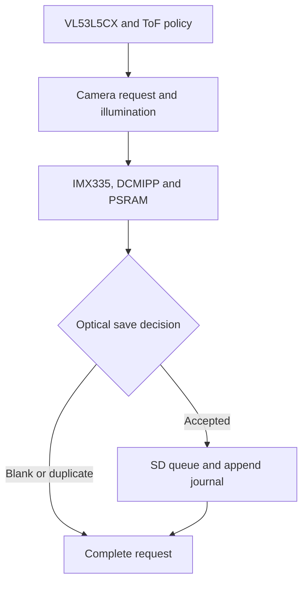
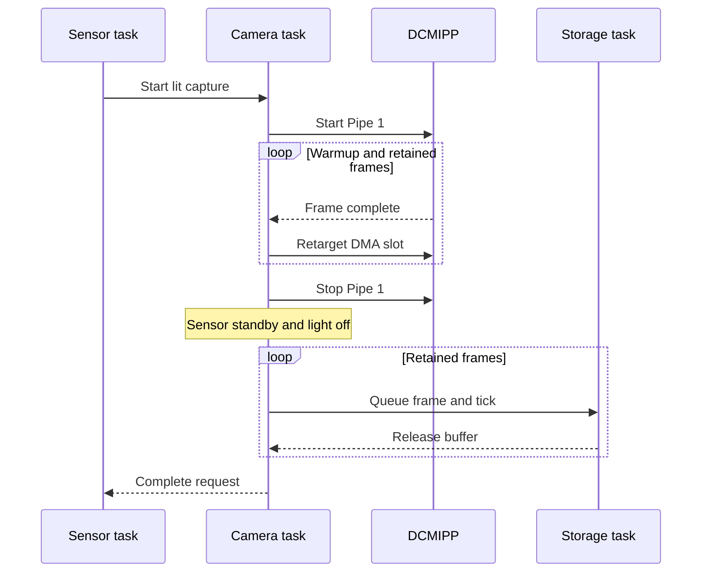

# MASSIF firmware and operating modes

[Repository README](../README.md) · [Camera pipeline and extension guide](MASSIF-Camera-Pipeline.md)

The profiles below describe the source and firmware defaults on `feature-cameraToF`. Compile-time overrides can select another path. Record the commit and your effective defines with each bench run.

## System architecture

In the default profile, [`main.c`](../x-cube-n6-camera-capture-main/nucleo/x-cube-n6-camera-capture-main/Src/main.c) initializes the clocks, memory, peripherals and camera before setting `system_ready`. `main_freertos()` creates the tasks and `main_thread_fct()` performs startup. The camera and ToF share I²C1. [`i2c_arbiter.c`](../x-cube-n6-camera-capture-main/nucleo/x-cube-n6-camera-capture-main/Src/i2c_arbiter.c) provides the camera I²C access wrappers. [`app_thread.c`](../x-cube-n6-camera-capture-main/nucleo/x-cube-n6-camera-capture-main/Src/app_thread.c) owns the camera/storage command queues, completion semaphores and task coordination.

| Execution context | What it owns | Where to start |
| --- | --- | --- |
| Sensor task | ToF samples, event policy, illumination start, request and post-capture cooldown | `sensor_task()`, `Capture_RequestSnapshot()` in [`app_thread.c`](../x-cube-n6-camera-capture-main/nucleo/x-cube-n6-camera-capture-main/Src/app_thread.c) |
| Camera task | Native acquisition, optical decisions and storage command submission | `camera_task()`, `CaptureSelectedPhoto()` in [`app_thread.c`](../x-cube-n6-camera-capture-main/nucleo/x-cube-n6-camera-capture-main/Src/app_thread.c) |
| Camera interrupt callback | Pipe 1 frame completion notification | `CMW_CAMERA_PIPE_FrameEventCallback()` in [`app.c`](../x-cube-n6-camera-capture-main/nucleo/x-cube-n6-camera-capture-main/Src/app.c), then `CAM_NotifyFrameEvent()` in [`app_cam.c`](../x-cube-n6-camera-capture-main/nucleo/x-cube-n6-camera-capture-main/Src/app_cam.c) |
| Storage task | Raw writes, reinit and retry, and return of pixel-buffer ownership | `storage_task()`, `SD_StoreRawImage()`, `SD_Reinit()` in [`app_thread.c`](../x-cube-n6-camera-capture-main/nucleo/x-cube-n6-camera-capture-main/Src/app_thread.c) |
| Button task, mode 0 | Manual capture and synchronous storage | `btn_thread_fct()`, its file-local `SD_StoreRawImage()` in [`main.c`](../x-cube-n6-camera-capture-main/nucleo/x-cube-n6-camera-capture-main/Src/main.c) |

In the default profile and the fixed-window callback batch, the camera task waits for storage completion before releasing the transaction. The sensor task is waiting during acquisition and storage, leaving a gap in processed ToF observations. On a request timeout these two profiles turn off illumination and wait for the outstanding completion before permitting buffer reuse. A successful camera request can also be a deliberate zero-write decision.

## Operating modes

### On-demand capture

Build with `CAPTURE_MODE=0` and `TEST_TOF_MODE=0`. The default `CAM_BINNING=0` selects the full 2592 × 1944 output, with `SNAP_WARMUP_FRAMES=8`. Green indicates ready. A debounced USER press on PC13 starts the ring and `btn_thread_fct()` calls `CAM_CaptureSingleFrame()` directly.

1. Initialize the camera for this press, apply exposure/gain and run Pipe 1 into a single PSRAM slot.
2. Wait on frame completions through warmup and retain the final frame. Stop the pipe, invalidate the DMA destination cache and deinitialize. A frame timeout or capture/stop failure rejects the image.
3. Turn the ring off, take an RTC stamp, reinitialize the SD interface and write through the button task's raw writer. A failed write gets one recovery attempt if reinitialization succeeds.
4. Restore the ready indication and wait for button release. One press yields at most one record. ToF, optical localization and the asynchronous save queue are outside this path.

### Mode 4 with overview and dynamic crop

The checked-in settings resolve to `CAM_OVERVIEW_CROP=1` and `CAM_NATIVE_ROI=0`. `CAM_CallbackInit()` initializes the full-field camera at boot and leaves it in standby. Each accepted ToF event wakes the camera, uses five full-field warmup frames and retains **one** 2592 × 1944 YUYV snapshot. `CAM_CaptureFullFrame()` uses continuous mode for warmup, then captures the retained frame in snapshot mode to prevent the next frame from overwriting it. After acquisition the sensor returns to standby and the ring goes off.

`CAM_LocalizeFrame()` estimates where the object lies. `SelectPhoto()` decides which records to write. With `CAM_FIRST_IMAGE_DIVISOR=2`, the saved overview is 1296 × 972. The native crop is read from the original 5 MP source, with the same RTC/tick metadata as its overview. Its pixels remain at acquisition scale. The number of saved records is independent of `CALLBACK_FRAMES`.

| Optical result | Records |
| --- | --- |
| Reference initialization, confirmed blank, or duplicate position | None |
| Uncertain object or fragmented change | `overview_uncertain` |
| Single usable object and crop fits | `overview` + `native_crop` |
| Single object with oversized crop | `full_large` + `overview_large` |
| Multiple accepted components | `full_multi` + `overview_multi` |

### Mode 4 callback batch (snap batch)

Set `CAM_OVERVIEW_CROP=0` with `CAPTURE_MODE=4`. The derived `CAM_NATIVE_ROI=1` selects the fixed **DCMIPP window** at `(976,584)` with size `640 × 768`. It limits the delivered pixels at native scale. The sensor still reads its full field. This mode stores separate exposures from the same fixed window on each accepted ToF event.

1. `CAM_CallbackInit()` prepares the camera at boot. `CAM_CallbackBatchSnap()` wakes it and starts Pipe 1 once with two DMA scratch destinations.
2. Wait for frame-completion events. With the checked-in callback settings, discard 13 warmup frames and retain two. As each DMA slot completes, retarget it two frames ahead so retained frames land directly in consecutive batch slots.
3. Stop Pipe 1 once after the burst, put the sensor in standby and turn illumination off. The camera task queues each retained frame with its own capture tick and waits for storage between frames. A short burst can save a partial set while the request reports failure. A missed completion or failed pipe stop can invalidate the burst.

| Additional profile | Behavior and verification scope |
| --- | --- |
| `CAPTURE_MODE=4`, `CAM_OVERVIEW_CROP=0`, explicit `CAM_NATIVE_ROI=0` | Older multi-resolution path. The first callback frame is scaled from 1296 × 972 to 640 × 480 for `IF_Process()`. The firmware saves the batch, then attempts separate IMX335 AREA3 cropped exposures with `CAM_CaptureROI()`. Keep the expected 1296 × 972 input when investigating this path and validate it separately. |
| `CAPTURE_MODE=1` | Continuous camera with ToF-triggered frame copy via `CAM_ContinuousStart()` and `CAM_ContinuousSnap()`. Uses the compiled snapshot dimensions. |
| `TEST_TOF_MODE=1` with `CAPTURE_MODE=4` | Board LED and console events with camera and SD initialization bypassed. Useful to observe range and trigger behavior without the gaps caused by image processing or storage. |

## ToF trigger and baseline

The default [`app_config.h`](../x-cube-n6-camera-capture-main/nucleo/x-cube-n6-camera-capture-main/Inc/app_config.h) selects one VL53L5CX, 16 zones, autonomous ranging mode 3, 45 ms integration, 15 Hz requested and closest-target order. `VL53L5CX_LearnBaseline()` discards 15 settling samples before attempting 30 baseline samples. It records per-zone signal and distance references. This reference lives in the range detector and is separate from the image of the empty passage.

| Logic | Main functions and files |
| --- | --- |
| Bring up I²C and the sensor, configure ranging and learn the baseline | `VL53L5CX_I2C_Init()` in [`main.c`](../x-cube-n6-camera-capture-main/nucleo/x-cube-n6-camera-capture-main/Src/main.c). `VL53L5CX_Init()`, `VL53L5CX_Configure()`, `VL53L5CX_StartRanging()`, `VL53L5CX_LearnBaseline()` in [`vl53l5cx_detection.c`](../x-cube-n6-camera-capture-main/nucleo/x-cube-n6-camera-capture-main/Src/vl53l5cx_detection.c). |
| Read a fresh frame and evaluate per-zone evidence | `VL53L5CX_Update()` and `VL53L5CX_TestDetectionStep()` in [`vl53l5cx_detection.c`](../x-cube-n6-camera-capture-main/nucleo/x-cube-n6-camera-capture-main/Src/vl53l5cx_detection.c). The latter also serves the default camera profile despite its name. |
| Apply capture policy and release stale pre-capture evidence | `sensor_task()` in [`app_thread.c`](../x-cube-n6-camera-capture-main/nucleo/x-cube-n6-camera-capture-main/Src/app_thread.c) and `VL53L5CX_ZoneDetectorAfterCapture()` in [`vl53l5cx_detection.c`](../x-cube-n6-camera-capture-main/nucleo/x-cube-n6-camera-capture-main/Src/vl53l5cx_detection.c). |

The 4 × 4 detector subtracts the cross-zone median change to isolate localized signal and distance residuals. It evaluates local level changes, fast edges and same-zone weak evidence accumulated over time. Micro-persistence is enabled. Weak spatial tracking and the trigger-zone mask are disabled in the checked-in profile. ST motion values help evaluate scene/zone behavior. The sensor's global motion flag alone does not issue a camera command. Latches suppress repeated events while the same evidence persists. Quiet-zone drift tracking and coherent-scene checks handle different kinds of baseline movement.

The sensor task still evaluates fresh frames during frame cooldown with event dispatch blocked. After the camera request, it clears stale history and starts a five-frame cooldown. The current high-sensitivity profile also enables a full baseline refresh after one camera activation, a three-second restricted re-arm window, and a periodic baseline refresh five minutes after the last full baseline. In re-arm, the policy permits level and fast-edge classes when the frame cooldown has cleared. Activation counts the request path, including a camera decision that yields zero saved files. Full refresh can learn a target still in the passage, so inspect the event, refresh and save messages together during testing.

Use `TOFEVT` for accepted detector events, `TOFMISS` for blocked candidates and `TOFCAL` for per-zone calibration detail when enabled. `[CAM][SELECT]` reports the independent optical decision. The [ToF field notes](archive/project/TOF_DETECTION_FIELD_GUIDE.md) provide historical calibration methods. Use the active header and source for current settings.

## Camera, optical detection and ROI

| Component | Main files and functions |
| --- | --- |
| IMX335, camera middleware and DCMIPP | [`app_cam.c`](../x-cube-n6-camera-capture-main/nucleo/x-cube-n6-camera-capture-main/Src/app_cam.c), [`app_cam.h`](../x-cube-n6-camera-capture-main/nucleo/x-cube-n6-camera-capture-main/Inc/app_cam.h), [CMW](../x-cube-n6-camera-capture-main/nucleo/x-cube-n6-camera-capture-main/Lib/Camera_Middleware/cmw_camera.c) and [IMX335 adapter](../x-cube-n6-camera-capture-main/nucleo/x-cube-n6-camera-capture-main/Lib/Camera_Middleware/sensors/cmw_imx335.c). Start with `CAM_Init()`, `DCMIPP_PipeInitCapture()` and the selected acquisition function. |
| Default optical localization | `CAM_LocalizeFrame()`, `CAM_FindForeground()` and `CAM_FitBurstWindow()` in [`app_cam.c`](../x-cube-n6-camera-capture-main/nucleo/x-cube-n6-camera-capture-main/Src/app_cam.c). |
| Position filtering and output generation | `SelectPhoto()`, `CopyNativeCrop()`, `DownsampleFirstImage()` and `SaveOverviewCropImage()` in [`app_thread.c`](../x-cube-n6-camera-capture-main/nucleo/x-cube-n6-camera-capture-main/Src/app_thread.c). |
| Fixed DCMIPP crop | `CAM_InitCropConfig()` and `DCMIPP_PipeInitCapture()` in [`app_cam.c`](../x-cube-n6-camera-capture-main/nucleo/x-cube-n6-camera-capture-main/Src/app_cam.c). |
| Older optical pipeline and sensor ROI | `IF_Process()` in [`image_filter.c`](../x-cube-n6-camera-capture-main/nucleo/x-cube-n6-camera-capture-main/Src/image_filter.c) and `CAM_CaptureROI()` / `CAM_SetSensorROI()` in [`app_cam.c`](../x-cube-n6-camera-capture-main/nucleo/x-cube-n6-camera-capture-main/Src/app_cam.c). |

The default optical detector samples luma on a 16-pixel grid and initializes its reference from the first usable bright image. It adjusts for median illumination shift, identifies dark foreground and groups adjacent cells. The bounds, component size, foreground limits and fixture-mark exclusion all affect whether a box is usable. `CAM_FitBurstWindow()` pads the native box, clips it to the frame and aligns the packed YUYV crop. `SelectPhoto()` compares a single-object center with the last successfully saved position. A close repeat within the configured window can be suppressed. Multiple components can belong to one physical insect. See the [camera extension guide](MASSIF-Camera-Pipeline.md) for detector return values, crop coordinates and the external backend contract.

Full-field YUYV uses 10,077,696 bytes per frame. The default pipeline uses one native allocation and a 2 MiB slot shared between optical scratch and a packed crop. Copy the crop before in-place overview reduction. If saving a full native fallback, wait for storage to release the source before resizing it. Keep the 32-byte DMA/cache alignment and check the linker map when changing buffers. The [CubeIDE linker script](../x-cube-n6-camera-capture-main/nucleo/x-cube-n6-camera-capture-main/Gcc/STM32N657xx.ld) maps a 16 MiB PSRAM region and separates it from internal AXI SRAM.

## Raw SD storage and time

Capture modes write sector-aligned records using 512-byte blocks. Each record starts with a 64-byte [`sd_image_header_t`](../x-cube-n6-camera-capture-main/nucleo/x-cube-n6-camera-capture-main/Inc/raw_image.h), then the payload and sector padding. The header records dimensions, format, size, persistent image ID, UTC validity, tick and image category. `RTC_CaptureStamp()` in [`ds3231.c`](../x-cube-n6-camera-capture-main/nucleo/x-cube-n6-camera-capture-main/Src/ds3231.c) supplies RTC metadata. UTC comes from an RTC sample taken after capture. The capture tick is a boot-relative millisecond timer. Use both fields to inspect ordering, and check the valid flag before relying on UTC.

- **On-demand writer** runs directly in [`main.c`](../x-cube-n6-camera-capture-main/nucleo/x-cube-n6-camera-capture-main/Src/main.c). **Autonomous writer** runs in `storage_task()` in [`app_thread.c`](../x-cube-n6-camera-capture-main/nucleo/x-cube-n6-camera-capture-main/Src/app_thread.c). Both use the HAL entry points wrapped by [`raw_image.h`](../x-cube-n6-camera-capture-main/nucleo/x-cube-n6-camera-capture-main/Inc/raw_image.h).
- **Append journal** in [`sd_storage_journal.c`](../x-cube-n6-camera-capture-main/nucleo/x-cube-n6-camera-capture-main/Src/sd_storage_journal.c) uses alternating CRC-protected records at sectors 3070 and 3071. `sdj_load()` selects the latest valid record. `sdj_reserve_image()` checks physical capacity and persists the next block and ID before the payload write. `SDJ_HAL_SD_WriteBlocks()` remaps the logical write to the reserved location. The CubeIDE project includes the journal through [`perf_debug.c`](../x-cube-n6-camera-capture-main/nucleo/x-cube-n6-camera-capture-main/Src/perf_debug.c).
- **Recovery** can leave a gap after a reservation or part of an overview/crop pair. The pair is two independent records. The firmware's successful-position reference advances only after the required writes succeed. The runtime append bound comes from the available card blocks.
- **Host decoder** uses [`raw_image_metadata.py`](../raw_image_metadata.py) and [`_sd_image_viewer_core.py`](../_sd_image_viewer_core.py) to parse headers and scan records. The viewer shows number, resolution, category, time and filename. Review the viewer's base-block and journal handling before changing the sector layout.

## Configure the firmware

Start with [`Inc/app_config.h`](../x-cube-n6-camera-capture-main/nucleo/x-cube-n6-camera-capture-main/Inc/app_config.h). It mixes guarded defaults, fixed defines and derived sizes. Check the active conditionals and CubeIDE compiler defines before assuming the value from a comment applies. Build profiles select the camera path before hardware initialization.

| Header group | Controls to look for | Current profile or dependency |
| --- | --- | --- |
| Capture and ROI | `CAPTURE_MODE`, `CAM_OVERVIEW_CROP`, `CAM_NATIVE_ROI`, `CAM_BINNING`, `SNAP_*` | Select the profile first. `CAM_BINNING` refers to DCMIPP output scaling where applicable. The default profile explicitly acquires full-field regardless of the default nominal 1296 × 972 `SNAP_*` dimensions. |
| Overview, localization and position | `CAM_FIRST_IMAGE_DIVISOR`, `CAM_FULL_WARMUP_FRAMES`, `CAM_CROP_DETECTOR`, `CAM_DYNAMIC_CROP_MARGIN`, `CAM_ROI_*`, `CAM_TRACK_*` | Divisor 2, five warmup frames, white-background detector, 96 px margin, 64 px movement threshold and 20 s gap. Coordinates and margins are native pixels. |
| Image quality | `CAM_EXPOSURE_MODE`, `CAM_EXPOSURE_VALUE`, `CAM_GAIN_VALUE`, `CAM_SENSOR_REG_DEBUG` | Mode 1 requests manual exposure, 13,000 µs and 12,000 millidecibels. Compare with IMX335 register diagnostics when evaluating effective exposure. |
| Memory, SD and callback burst | `MAX_SNAP_FRAME_SIZE`, `BATCH_BUF_SIZE`, `CAM_BURST_CROP_BYTES`, `SD_BATCH_WRITE_BLOCKS`, `SD_BATCH_RECOVERY_GAP_MS`, `CALLBACK_*` | Sizes derive from the active path. The active header requests 1024 blocks per write chunk and 0 ms inter-chunk recovery gap. Callback frame count and warmup apply to the multi-frame path. |
| Time and button | `RTC_ENABLE`, `RTC_PRINT_TIME`, `RTC_SET_ON_BOOT`, `RTC_SET_UTC`, `BTN_*` | RTC enabled with boot-time setting disabled. USER capture uses software debounce in mode 0. |
| Illumination and diagnostics | `WS2812_*`, `APP_LOG_ANSI_COLORS`, `PERF_*`, `TEST_TOF_MODE` | Ring mode 1, color `0xC8B080`, brightness 100, colorized tags enabled and performance detail off by default. [`ws2812.c`](../x-cube-n6-camera-capture-main/nucleo/x-cube-n6-camera-capture-main/Src/ws2812.c) owns lighting start, stop and the idle off watchdog. |
| Ranging, thresholds and baseline | `VL53L5CX_DET_*`, `VL53L5CX_RANGING_MODE`, `VL53L5CX_DUAL_*`, `VL53L5CX_EXT_*` | Tune integration/frequency, thresholds, persistence/latches and refresh together. The external sensor and its thresholds apply to the optional dual-sensor path. |

## Bench verification

| Check | Expected observation |
| --- | --- |
| On-demand | One full-field frame per press. Hold the button to verify there is one capture until release. Check that the ring is off during SD writes. |
| Default mode, empty reference | Start with the passage clear. Confirm a valid ToF baseline, then `empty_reference_saved` on a qualifying empty camera exposure and no record for a subsequent confirmed blank. |
| Default mode, optical decisions | Test one centered target, small and large movement, exit/re-entry, an edge target, an oversized target and multiple separated components. Check selection logs, dimensions, matching timestamps on pairs and alignment with the overview. |
| Fixed-window callback burst | Trigger once. Confirm two separately timed 640 × 768 frames with the expected framing and the light off before storage. Check `PERF_CAMERA_FRAME_LOG` when investigating frame timing. |
| ToF events and recovery | Record empty-trap and target trials with `TOFEVT`, `TOFMISS` and baseline/re-arm messages. Compare with camera selection and SD output. Test noisy conditions and the elapsed interval before detection resumes. |
| SD and reboot | With a dedicated test card, verify append after a reboot, recovery after a card error, and decoding of both legacy and categorized records. Confirm saved record IDs and account for any incomplete pair. |

Use `full_ms` for camera acquisition, `detect_ms` for optical localization, `select_ms` for the decision, and `copy_ms`, `resize_ms` and `sd_ms` for the remaining stages. `camera_task_total_ms` covers the camera task transaction from entry. Use the trigger and post-capture logs to measure the interval during which new ToF observations go unprocessed. Record the log settings and card used when comparing timings.
