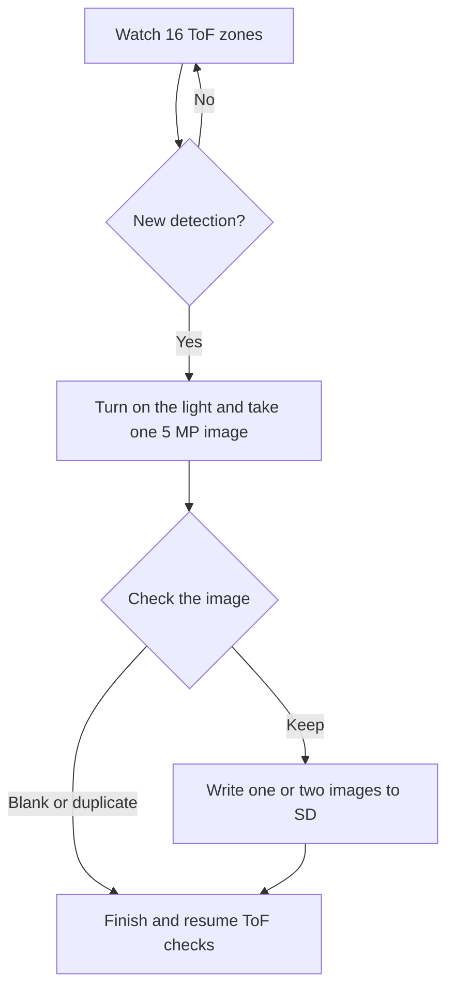

# How MASSIF detects an insect and saves an image

This guide follows the default automatic capture mode on `feature-cameraToF`. The [firmware guide](firmware-guide.md) links to the code and covers the settings for manual capture and callback batch.

## One event from start to finish

1. **Learn the empty passage.** At startup, the time-of-flight (ToF) sensor learns the usual distance and return signal in each of its 16 zones. The camera builds a separate reference of the empty passage from the first bright image it captures. Keep the passage clear for both. Wait for `empty_reference_saved` before testing image detection with a target.
2. **Decide when to take a photo.** The ToF algorithm compares each zone with its reference. It subtracts the typical change across the grid to reduce the effect of motion shared by many zones. A strong local change, a fast change with enough local evidence, or a weak change that lasts in one zone can trigger a capture. The detector remembers which zones have already triggered. This helps avoid another photo while the same change is still present.
3. **Capture once, then check the image.** The ring lights the passage. The camera wakes, discards five warmup frames and keeps one full 2592 × 1944 image. The light goes off before the firmware checks the image. It compares sampled brightness against the empty reference, compensates for an overall brightness change and groups neighboring dark samples into possible objects.
4. **Save what is useful.** A small object usually yields two images from the same exposure. The overview shows the whole passage at 1296 × 972. The crop keeps the original pixels around the object. Then the firmware finishes any SD writes and resumes ToF checks.

| What the image check finds | What goes on the card |
| --- | --- |
| Empty reference, confirmed blank, or a repeat close to the last saved position | Nothing |
| Uncertain result | Overview only |
| One object with room for the crop | Overview + original-resolution crop |
| Several separate dark regions, or a crop that would take too much memory | Overview + full 5 MP image |

The crop is the **region of interest (ROI)**. The firmware adds a margin around the object. For a single object, it usually saves again once the center moves at least 64 pixels from the **last saved** position. Several small movements can add up to the next saved photo. The position check can also reset after a gap or an uncertain observation.

## Settings that shape the result

These are the defaults in [`app_config.h`](../x-cube-n6-camera-capture-main/nucleo/x-cube-n6-camera-capture-main/Inc/app_config.h).

| What you want to understand | Settings and effect |
| --- | --- |
| How often ToF checks the passage | A 4 × 4 grid at a requested 15 frames/s with 45 ms integration. While the camera and SD are busy, the firmware pauses its ToF checks. |
| How a small, slow target triggers | `VL53L5CX_DET_MICRO_*` gives a floor zone +2 points for a local change of at least 1% signal or 2 mm distance. A quiet frame subtracts 1 point when level events are allowed. At 32 points the evidence can trigger a photo. From zero, that takes 16 qualifying frames with no decay. |
| When detection resumes | After each camera request, the default build refreshes the ToF baseline, then sets a five-frame cooldown. Each new ToF frame counts down, and a trigger is allowed when the count reaches zero. For three seconds after the refresh, only level changes and fast changes are eligible once the five-frame wait has cleared. A refresh can also run after five minutes without a full baseline update. |
| How long the camera prepares | `CAM_FULL_WARMUP_FRAMES=5`. Fewer warmup frames shorten the camera step and can change image brightness or consistency. `CAM_EXPOSURE_VALUE` requests 13 ms in manual mode. |
| Which dark features become objects | `CAM_ROI_GRID_STEP=16` samples every 16 pixels. `CAM_ROI_LUMA_DELTA=26` sets the minimum brightness difference and `CAM_ROI_MIN_COMPONENT=3` sets the minimum group size. |
| How much to save | `CAM_FIRST_IMAGE_DIVISOR=2` halves each overview dimension. `CAM_DYNAMIC_CROP_MARGIN=96` adds context in original pixels. `CAM_TRACK_MIN_DISTANCE_PX=64` and `CAM_TRACK_MAX_GAP_MS=20000` control the repeat filter. |

## What limits performance

Two times matter in the field. **Time to photo** determines how far an insect can move before the camera sees it. **Time to the next ToF check** determines whether a second insect could pass while the system is busy. The second interval includes image processing, any SD writes, and any baseline refresh on that path. A full-image fallback writes about 9.6 MiB for the original image alone. Blank and duplicate images skip the card write and still take camera time.

| To measure | Look at |
| --- | --- |
| Camera wake and warmup through the retained image | `full_ms` on `[CAM][FULL]` |
| Time until the light turns off on the saved-image path | `first_capture_to_light_off_ms` on `[CAM][TIME]` |
| Image check, resizing and SD write time | `detect_ms`, `resize_ms`, `sd_ms` |
| Whole camera task, including any writes | `camera_task_total_ms` |
| Time until the detector is ready for another event | Compare the capture and baseline logs with the first fresh ToF readings. Include the cooldown when testing when another event can trigger. |

Use the same card, settings and test movement when comparing runs. Count ToF triggers per minute with an empty passage, and count passes with a usable saved image out of a known number of test passes. Use several speeds to see how capture timing affects the result. See the [bench checklist](firmware-guide.md#bench-verification) for the individual checks.
