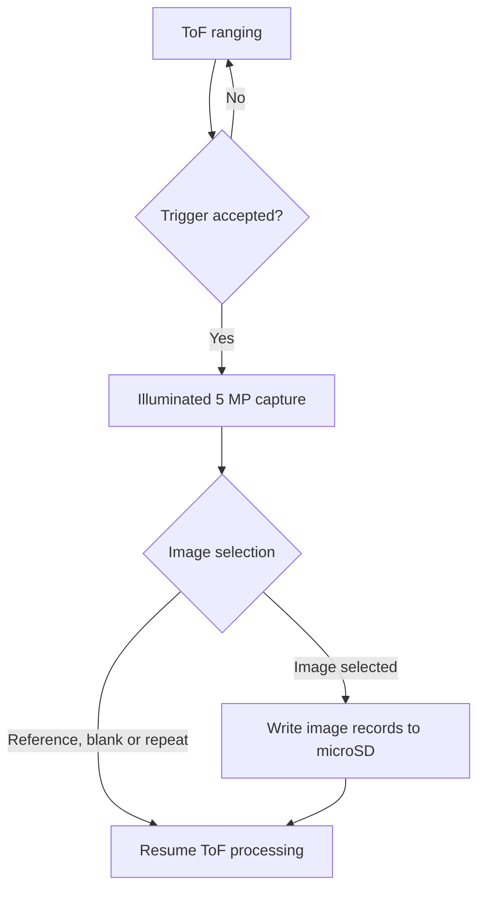

# MASSIF system operation and performance

This document describes the automatic capture configuration on `feature-cameraToF` (`CAPTURE_MODE=4`, `CAM_OVERVIEW_CROP=1`). Manual capture, callback batch and implementation details are documented in the [firmware guide](firmware-guide.md).

## Detection and capture sequence

1. **Reference acquisition.** At startup, the ToF detector estimates the baseline distance and return signal in each of its 16 zones. The optical detector establishes a separate empty-passage reference from the first qualifying camera exposure. The passage must be empty for both measurements. The message `empty_reference_saved` marks completion of optical reference acquisition.
2. **ToF detection.** The detector compares each zone with its baseline and subtracts the median change across zones to reduce the effect of changes shared across the grid. A strong local change, a rapid change supported by local evidence, or a persistent weak change can trigger capture. A per-zone latch limits repeated triggers from persistent evidence.
3. **Image acquisition and analysis.** The ring illuminates the passage while the camera discards five warmup frames and acquires one 2592 × 1944 image. The light switches off before image analysis. The detector compares sampled brightness with the optical reference, compensates for changes in overall illumination and groups neighboring dark samples.
4. **Image selection and storage.** The selection logic determines which records to write. An overview and its accompanying crop or full-size image are derived from the same exposure. The sensor task resumes after the camera and storage tasks complete.

## Image selection

| Image classification | Stored output |
| --- | --- |
| Empty reference, confirmed blank, or a repeat close to the last saved position | Nothing |
| Uncertain result | Overview only |
| One object with room for the crop | Overview + original-resolution crop |
| Several separate dark regions, or a crop that would take too much memory | Overview + full 5 MP image |

The region of interest (ROI) encloses the detected object and a margin. For a single object, repeat suppression uses the center of the last saved detection as its reference. The default minimum displacement is 64 pixels at full resolution. The filter also accounts for elapsed time and uncertain detections.

## Nominal configuration

These are the defaults in [`app_config.h`](../x-cube-n6-camera-capture-main/nucleo/x-cube-n6-camera-capture-main/Inc/app_config.h).

| Parameter group | Default value and function |
| --- | --- |
| ToF sampling | A 4 × 4 grid at a requested 15 frames/s with 45 ms integration. While the camera and SD are busy, the firmware pauses its ToF checks. |
| Persistent weak changes | `VL53L5CX_DET_MICRO_*` gives a floor zone +2 points for a local change of at least 1% signal or 2 mm distance. A quiet frame subtracts 1 point when level events are allowed. At 32 points the evidence can trigger a photo. From zero, that takes 16 qualifying frames with no decay. |
| Baseline refresh and cooldown | After each camera request, the default build refreshes the ToF baseline, then sets a five-frame cooldown. Each new ToF frame counts down, and a trigger is allowed when the count reaches zero. For three seconds after the refresh, only level changes and fast changes are eligible once the five-frame wait has cleared. A refresh can also run after five minutes without a full baseline update. |
| Camera warmup and exposure | `CAM_FULL_WARMUP_FRAMES=5`. Fewer warmup frames shorten the camera step and can change image brightness or consistency. `CAM_EXPOSURE_VALUE` requests 13 ms in manual mode. |
| Foreground detection | `CAM_ROI_GRID_STEP=16` samples every 16 pixels. `CAM_ROI_LUMA_DELTA=26` sets the minimum brightness difference and `CAM_ROI_MIN_COMPONENT=3` sets the minimum group size. |
| Image size and repeat suppression | `CAM_FIRST_IMAGE_DIVISOR=2` halves each overview dimension. `CAM_DYNAMIC_CROP_MARGIN=96` adds context in original pixels. `CAM_TRACK_MIN_DISTANCE_PX=64` and `CAM_TRACK_MAX_GAP_MS=20000` control the repeat filter. |

## Performance metrics

Capture latency affects the position of the insect in the image. The interval before ToF processing resumes affects the ability to detect a second passage. This interval includes capture, image analysis, any SD writes and any baseline refresh. A full-size image adds approximately 9.6 MiB of pixel data to the SD write.

| Metric | Log field or measurement method |
| --- | --- |
| Camera wake and warmup through the retained image | `full_ms` on `[CAM][FULL]` |
| Time until the light turns off on the saved-image path | `first_capture_to_light_off_ms` on `[CAM][TIME]` |
| Image check, resizing and SD write time | `detect_ms`, `resize_ms`, `sd_ms` |
| Whole camera task, including any writes | `camera_task_total_ms` |
| Time until the detector is ready for another event | Interval from the accepted trigger to the first eligible post-capture trigger. Baseline refresh and cooldown contribute to this interval. |

Bench trials use a fixed SD card and configuration. Empty-passage trials report ToF triggers per minute. Controlled passages at several speeds report the proportion of passes that produce a usable image. Test conditions and expected observations are listed in [Bench verification](firmware-guide.md#bench-verification).
