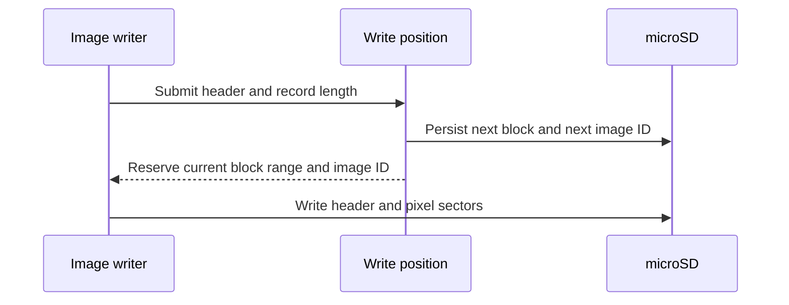

# SD storage and image reconstruction

The STM32N6 stores image records directly in microSD sectors. Each record contains a header, a packed pixel array and padding to the end of the final sector. The Windows viewer reads the sectors and reconstructs display and export images. This document describes the current writer and the Windows entry point. [Firmware guide](firmware-guide.md#raw-sd-storage-and-time)

## From the camera buffer to the card

| Capture path | Write sequence |
| --- | --- |
| On-demand | The button task in `main.c` writes the full frame synchronously. |
| Automatic overview and crop | The camera task queues one record at a time and waits for the SD task to finish reading its buffer. A crop pair is written as overview then crop. A full-image pair is written as full image then overview. |
| Fixed-window callback batch | The camera task queues each retained frame using its capture timestamp and waits for the corresponding write before proceeding. |

`SD_StoreRawImage()` prepares a header and stages consecutive sectors in the SD batch buffer. In the automatic path the pixel checksum is the XOR of the payload bytes. The writer performs cache maintenance before handing a block batch to the SD interface. `storage_task()` handles recovery and a retry after a failed write when SD reinitialization succeeds. Its completion signal allows the camera to reuse the source memory.

## Persistent write position

Blocks 3070 and 3071 hold two copies of the write-position record, referred to as the SD journal in the firmware. The data region starts at block 3072. The journal stores a sequence number, the next block and image ID, a format identifier and a CRC. The writer selects the newest valid copy and updates the alternate copy for each reservation.

`SDJ_HAL_SD_WriteBlocks()` recognizes the first chunk by its header. It substitutes the card's persistent image ID and maps subsequent writes to the reserved physical sectors. The reservation is checked against the available card blocks. A failed payload write can leave an incomplete record or a gap because the next write position has already advanced. A retry can reserve another range and assign another ID. A crop pair consists of two independently written records, so interruption can leave one member of the pair.

If both position records are invalid, the firmware initializes the position at block 3072 with image ID zero. It does not rebuild the append position from existing images. For a card containing images to preserve, reconstruction on the host should precede reuse in the firmware.

## Record layout

The header occupies bytes 0–63 of the first sector. Its integer fields are unsigned 32-bit little-endian values. Pixel data begins at byte 64.

| Byte offset | Fields |
| --- | --- |
| 0 | Magic value `0x49444745`. The stored byte sequence reads `EGDI`. |
| 4–16 | Width, height, pixel format and payload length, at four-byte intervals. |
| 20–28 | Timestamp, pixel checksum and persistent image ID. |
| 32–40 | RTC marker, time flags and capture tick. |
| 44 | Image category, such as overview or native crop. |
| 48–63 | Reserved bytes. |

For a payload of N bytes, the writer reserves `ceil((64 + N) / 512)` sectors. The current format is YUYV, a packed YUV 4:2:2 layout with two bytes per pixel on average. For each horizontal pair the byte order is `Y0 U Y1 V`. Both pixels share the U and V samples. Thus a 1296 × 972 overview contains 2,519,424 pixel bytes and occupies 4,921 sectors including its header and padding.

The RTC marker and flags indicate whether the timestamp contains valid UTC. The capture tick provides a millisecond counter relative to firmware startup. The viewer uses these fields for display and filename generation. The two records in an automatic image pair share an exposure timestamp but have distinct image IDs. [Raw header](../x-cube-n6-camera-capture-main/nucleo/x-cube-n6-camera-capture-main/Inc/raw_image.h) · [Metadata decoder](../raw_image_metadata.py)

## Finding and reconstructing images

1. **Scan.** `ScanThread` tries block 3072 and the legacy base at block 1000. For a valid header, it advances by the number of sectors calculated from that record's payload length. This supports mixed dimensions on one card. An invalid header advances by the legacy fallback stride, with a limit of 30 consecutive misses. The viewer takes the result with the most records.
2. **Search for headers if the stride scan returns no records.** The fallback reads up to 512 MiB from the current image base in 4 MiB chunks, looking for the magic at sector boundaries and applying the header checks. With variable-size gaps, a stride scan can recover some images while skipping later ones. A successful stride scan therefore does not establish that every record was found.
3. **Read and decode.** `LoadImageThread` or `ExtractThread` reads the indicated sectors and removes the 64-byte header. The decoder interprets the packed bytes as a height × width × 2 array, converts YUYV to RGB using OpenCV, and applies the viewer's white balance. The normal decoder accepts format 0. A valid scan result establishes plausible metadata rather than pixel integrity because these paths do not verify the stored pixel checksum.
4. **Display or export.** The reconstructed RGB image is displayed with its dimensions, category and time. Batch export saves the decoded images as PNGs at the stored dimensions. The output includes the viewer's color processing.

## Deletion and reset

In `SD_Image_Viewer.py`, deleting images clears their scanned record ranges. **Format SD** clears the scanned capture records and both write-position blocks, then reads back the position blocks to verify the reset. The Windows wrapper locks the relevant mounted volumes during raw writes. After a reset, the firmware initializes the position and ID on its next write. This operation targets the MASSIF capture area and write-position records.

[Image writer and SD task](../x-cube-n6-camera-capture-main/nucleo/x-cube-n6-camera-capture-main/Src/app_thread.c) · [On-demand writer](../x-cube-n6-camera-capture-main/nucleo/x-cube-n6-camera-capture-main/Src/main.c) · [Write-position implementation](../x-cube-n6-camera-capture-main/nucleo/x-cube-n6-camera-capture-main/Src/sd_storage_journal.c) · [Viewer scan and reconstruction](../_sd_image_viewer_core.py) · [Windows viewer](../SD_Image_Viewer.py)
